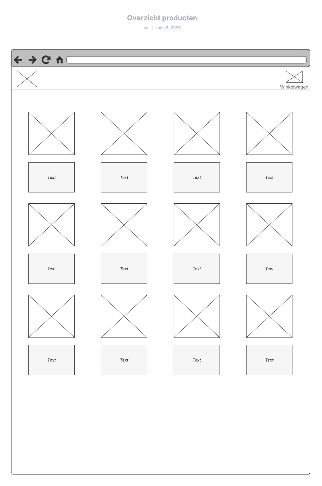
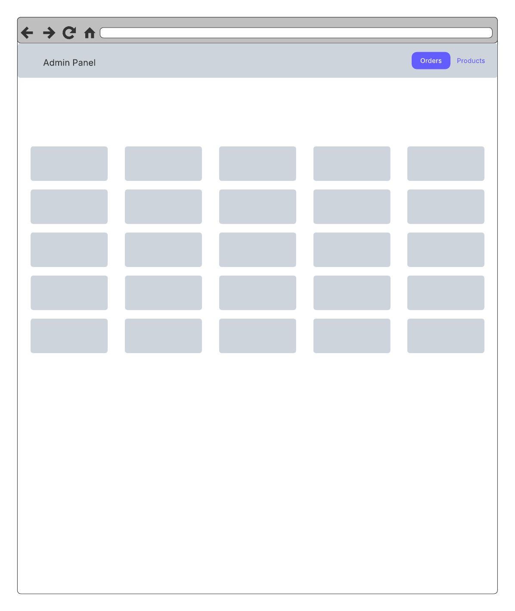

# Plan project LEGO webshop

## Soort webshop

Voor dit eindproject wordt een LEGO webshop gebouwd waar je verschillende LEGO-sets kunt bekijken en kopen. De website wordt gebouwd met HTML, CSS, JavaScript en Tailwind CSS (via Vite).

## Functionaliteiten

### Algemeen

De webshop moet online te bereiken zijn, heeft keuze uit 12 LEGO-sets (uit 'src/products.json') en moet bewerkt kunnen worden door een admin. Form-invoer wordt gevalideerd. Producten, de winkelwagen en bestellingen worden opgeslagen in localStorage, zodat alles bewaard blijft na het verversen van de pagina.

### Eindgebruiker

Op de website krijg je een overzicht te zien van alle sets uit 'src/products.json'. Deze sets kun je toevoegen aan de winkelwagen, en je ziet aan een rode badge/bolletje bij het winkelwagenicoon dat er producten in zitten. De winkelwagen kun je legen of bestellen. Bij het bestellen wordt de bestelling opgeslagen in localStorage en krijg je een bevestigingspagina te zien.

### Admin

Het admin-gedeelte is bereikbaar via '/admin' (en '/admin/products.html', etc. Zie 'public/\_redirects').
De admin heeft een overzicht van alle bestellingen, en kan producten toevoegen, bewerken of verwijderen. Bij het toevoegen van een product krijgt dit automatisch een uniek ID (hoogst bestaande ID + 1). Producten kunnen worden gereset naar de originele staat door 'src/products.json' opnieuw in te lezen, alle wijzigingen worden dan ongedaan gemaakt.

## Uiterlijk

De website heeft een navbar met het logo links en de winkelwagen rechts (gebruikersgedeelte), of het logo met 'Admin Panel' en "Orders"/"Products"-knoppen (admin-gedeelte). De LEGO-sets zijn zichtbaar als kaarten in een grid. In de winkelwagen zie je een tabel met wat je hebt toegevoegd en het totaalbedrag. Je krijgt een bevestiging te zien na het klikken op "Afrekenen". Bij de admin zijn er tabellen te zien met ID, totaal en datum/tijd bij bestellingen, en ID, naam, prijs en afbeelding-URL bij producten, met knoppen om te bewerken of te verwijderen.

